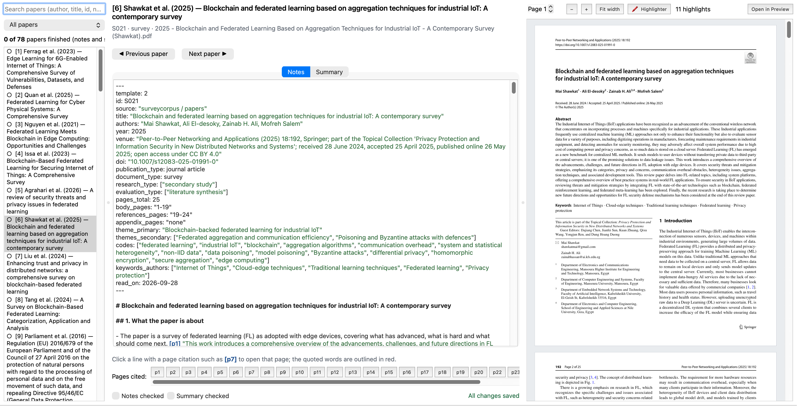
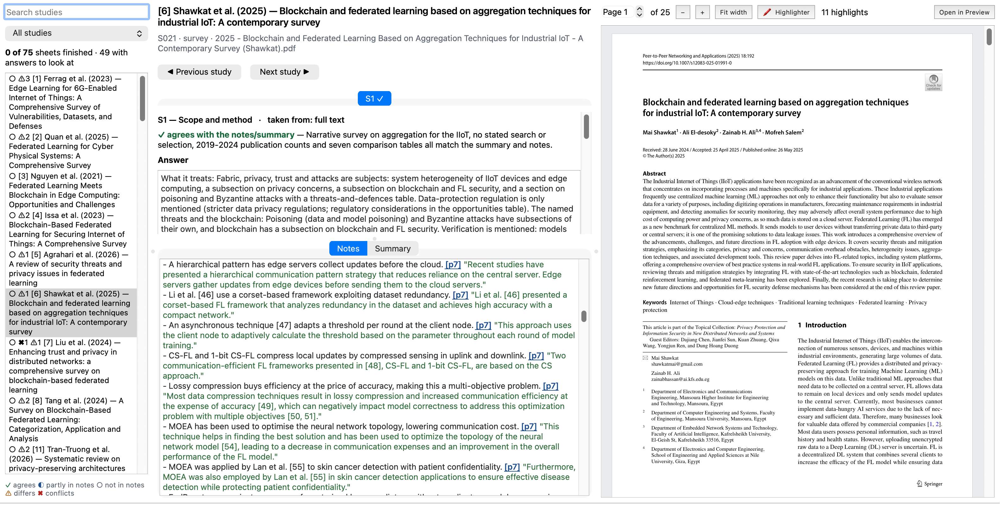
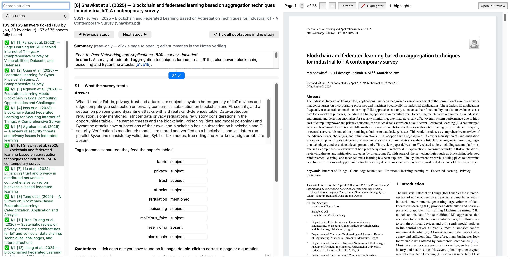
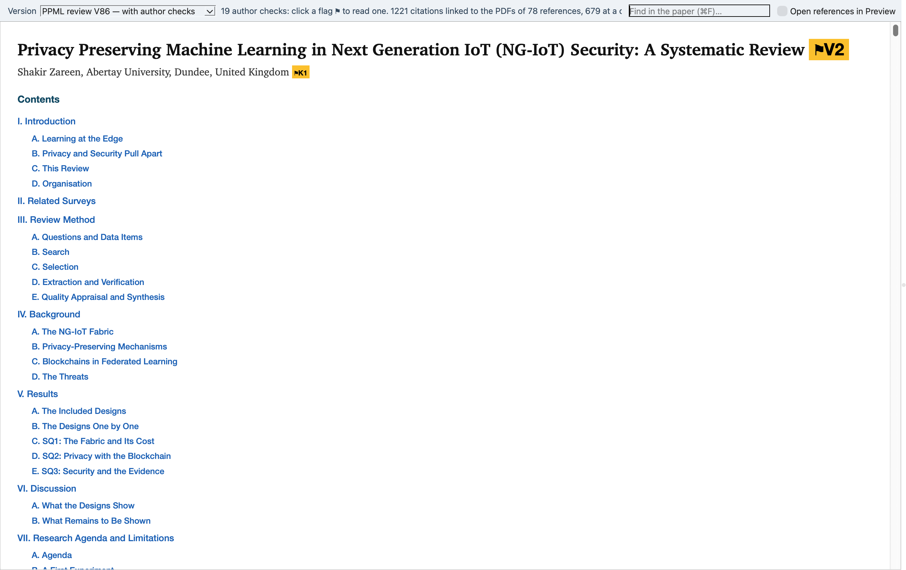
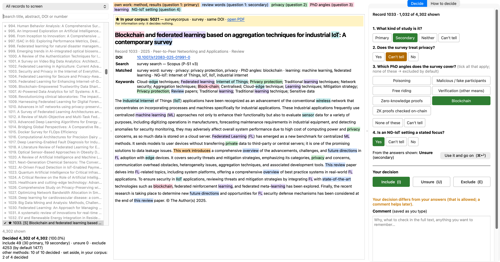
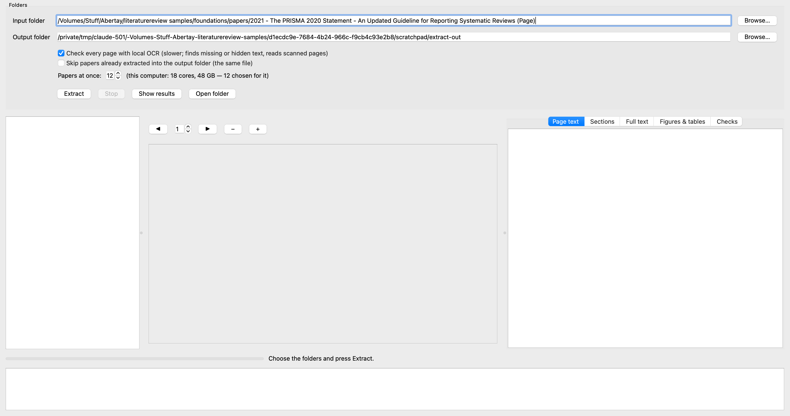
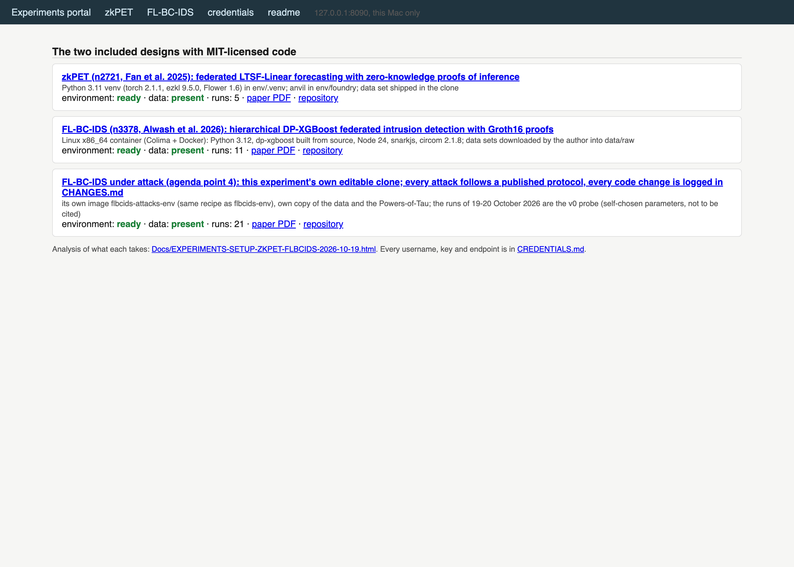

# The tools of the systematic review "Privacy Preserving Machine Learning in Next Generation IoT (NG-IoT) Security"

The scripts and applications built for the review, as used for version v86 of the paper. Licence: MIT. Cite with CITATION.cff.
The records the review is built on (search provenance, screening decisions, extraction records with their tags, the paper's parts and build outputs,
the experiment run summaries) are archived with these tools at Zenodo: https://doi.org/10.5281/zenodo.23895402. No paper text and no database export is published anywhere.

## What is here

| Folder | Tool |
|---|---|
| `scripts/paper_ppml/` | The paper pipeline: records to counts, tables and figures (`data.py`, `data_v68.py`, `experiment_v82.py`), the build (`build.py`), its checks (`verify_v68.py`, `check_claims_v68.py`, `style_check.py`, `claims_audit.py`), the local AI-text detection (`ai_detect_version.py`), the deck, the IEEE Access renderings, the release and deposit scripts. |
| `scripts/search_ppml/` | The recorded search: strings, merge of the exports, automated rules, the screening application. |
| `scripts/` | The extraction and OCR pipeline (`run_extraction.sh`, `verify_ocr.py`, `sections.py`, `check_extraction.py`). |
| `scripts/review/` | Shared primitives: the figure drawing, the Word look, the author checks, `app_screenshot.py`. |
| `local-checker/` | The local fact checker: statements against a paper's extracted text, on the machine (BM25 + a DeBERTa NLI classifier). |
| `notes-verifier/` | The Notes Verifier, the Evidence Verifier and the Sheet Reviewer (PySide6). |
| `myliteraturereviewpaper/linked-app/` | The Review Viewer. |
| `pdf-text-extractor/` | The PDF Text Extractor, a desktop app for macOS and Windows. |
| `experiments/` | The harnesses and environment recipes of the first experiment, and the portal. |
| `requirements/` | Pinned package lists of the environments the review ran with. `Docs/SCRIPTS-MAP.html` maps every script to the part of the paper it serves. |

Each folder has a README with the commands. Prerequisites: Python 3.12 or later; pandoc (the paper build); Google Chrome (the figures); TeX Live (the LaTeX rendering, optional); Tesseract (second OCR engine, optional); macOS for the Apple Vision OCR; Docker (the experiments).

## The applications

### Notes Verifier

a cited paper beside its notes and summary, to check and correct them. See [notes-verifier/README.md](notes-verifier/README.md).

### Evidence Verifier

a study's evidence sheet against its notes, summary and PDF. See [notes-verifier/README.md](notes-verifier/README.md).

### Sheet Reviewer

every fact of a sheet ticked against the PDF, with the quoted words outlined. See [notes-verifier/README.md](notes-verifier/README.md).

### Review Viewer

the review next to its sources: a citation opens the evidence, an evidence item opens the page. See [myliteraturereviewpaper/linked-app/README.md](myliteraturereviewpaper/linked-app/README.md).

### Screening application

title-and-abstract screening of the search records with a cue-word pre-fill, decisions logged. See [scripts/search_ppml/README.md](scripts/search_ppml/README.md).

### PDF Text Extractor

a folder of PDFs to per-page verified text, sections and figures (macOS and Windows). See [pdf-text-extractor/README.md](pdf-text-extractor/README.md).

### Experiments portal

one local page to start, watch and read the experiments. See [experiments/README.md](experiments/README.md).

Screenshots were taken by `scripts/review/app_screenshot.py` on the review's real records; where a paper is shown it is Shawkat et al. 2025, published under CC BY 4.0.

## Third-party code, models and data

None of it is redistributed here; the harnesses clone the repositories at the commits named and the paper cites the works. Cite them, not this repository, for what they contributed.

- **zkPET**: n2721 Code: https://github.com/CaixiangFan/zkpet (MIT, commit e96153d).
- **FL-BC-IDS**: n3378 Code: https://github.com/wisamalwashYildiz/FL-BC-IDS (MIT, commit 0bd5732).
- **FoolsGold (the Sybil label-flipping protocol)**: fung2020 Code: https://github.com/DistributedML/FoolsGold (MIT, commit 0aa5511).
- **Explanation-guided clean-label backdoor**: severi2021 Code: https://github.com/ClonedOne/MalwareBackdoors (MIT, commit 7e3ba27).
- **CICIoV2024 data set**: neto2024 https://www.unb.ca/cic/datasets/iov-dataset-2024.html (from its publisher).
- **Tabler Icons** (MIT): the icons of the figures, copies and licence in `myliteraturereviewpaper/ppml2026/icons/tabler/`.
- **DeBERTa-v3-large NLI model** by Moritz Laurer (`MoritzLaurer/DeBERTa-v3-large-mnli-fever-anli-ling-wanli` on Hugging Face), downloaded by the local checker at set-up; see its model card for the licence and the training data.

