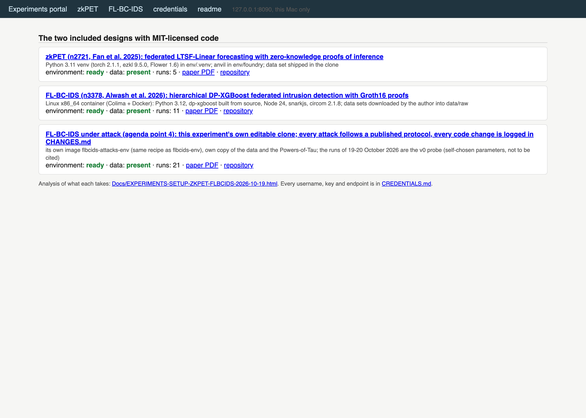

# Experiments on the two included designs that publish MIT-licensed code (set up 19 October 2026)

The paper's agenda (Section VII) states that experiment details will follow. Of the 45 included designs, three link to
code and two of those carry the MIT licence; both are cloned here with the paper's PDF beside them. Nothing has been run yet.
The analysis of what each takes to run is `Docs/EXPERIMENTS-SETUP-ZKPET-FLBCIDS-2026-10-19.html`.

| Folder | Design | Repository (clone of 19 Oct 2026) | Licence | Paper |
|---|---|---|---|---|
| `zkpet/` | n2721, Fan et al. 2025, zero-knowledge ML for blockchain peer-to-peer energy trading (Internet of Things) | `zkpet/repo/` = github.com/CaixiangFan/zkpet, 37 commits, last 2024-05-13 | MIT (2023 Stephen Fan) | `zkpet/paper/n2721.pdf` |
| `fl-bc-ids/` | n3378, Alwash et al. 2026, FL-BC-IDS hierarchical federated intrusion detection for the IoV (Sensors) | `fl-bc-ids/repo/` = github.com/wisamalwashYildiz/FL-BC-IDS, 4 commits, last 2026-08-26 | MIT | `fl-bc-ids/paper/n3378.pdf` |

Rules for this folder: the clones are third-party code under their own licences and are never edited in place (changes go in a
fork or a separate folder); raw data sets are downloaded into `<design>/data/` (not committed anywhere); every run writes its
command, environment and outputs into `<design>/runs/<date>-<name>/`; the paper PDFs are copies of the corpus files and stay
under the corpus rule (no paper text to Claude).

## The portal (19 October 2026, evening)

`bash experiments/portal.sh` (or double-click `Start Experiments Portal.command`, or the `Experiments Portal.webloc`) starts
`portal/portal.py` on http://127.0.0.1:8090/ (this Mac only, standard library only) and opens it. The page shows each
experiment's environment and data status, starts runs with parameters through the experiments' own scripts, lists the runs
with progress parsed from their logs, and for each run shows RUN.md, RESULTS.md, the results beside the repository's
reference numbers, a live log tail, the artefacts and a stop button. `portal/portal.log`, `portal/portal.pid`.

## zkPET: what has run (19 October 2026)

| Run folder | What | Outcome |
|---|---|---|
| `zkpet/runs/20261019-182422-fl-2clients` | the repository's federated training unchanged: Flower server + 2 clients, 3 rounds | 57 s; see RESULTS.md |
| `zkpet/runs/20261019-182650-zk-sites` | per-site Linear training + ezkl proving, sites 0–2, sequence 192, 10 proofs each, verified on anvil | prove 0.15 s, proof 15.4 KB, verifier 60.0 KB; see RESULTS.md |
| `zkpet/runs/20261019-183233-zk-sites-sl96` | the same at sequence 96 | prove 0.10 s, proof 15.4 KB; see RESULTS.md |
| `zkpet/runs/20261019-184015-zk-cli-sites` | the paper's command-line measurement repeated (ezkl binary under /usr/bin/time), 5 proofs per site | 0.15 s wall, 65 MB max RSS per proof process; see RESULTS.md |
| `zkpet/runs/20261019-183509-zk-multi` | the aggregated models of 10, 20 and 30 sites (46k–139k parameters, log-rows 17–19), 3 proofs each | 5.4 s / 10.9 s / 22.1 s per proof; proof sizes identical to the repository's; 8.3–8.6x faster than their server; see RESULTS.md |

Printable record of all zkPET runs: `Docs/EXPERIMENTS-ZKPET-RESULTS-2026-10-19.html` (regenerated by `zkpet/env/report.py`).

Environment of zkPET: `zkpet/env/.venv` (Python 3.11 by uv; `env/requirements-macos.txt` = the repository's requirements.txt
without its 24 CUDA-only pins), `env/foundry/` (anvil 1.5.1), `env/solcx/` + `env/bin/solc` (0.8.20 via py-solc-x), `env/ezkl-cli/`
(ezkl 9.5.0 binary for the command-line measurement). Drivers (ours, the clone untouched): `env/run_fl.sh`, `env/zk_sites.py`,
`env/start_anvil.sh`.

## FL-BC-IDS: what has run (19 October 2026)

Environment built: Colima profile `flbcids` (arm64 VM with Rosetta, the experiments folder mounted writable) and two images:
`flbcids-env:arm64` (2.8 GB, `env/Dockerfile.arm64`, the default: native Python and Ray, circom through Rosetta with Debian's
amd64 multiarch runtime) and `flbcids-env:amd64` (3.9 GB, `env/Dockerfile`; whole process under Rosetta, where Ray's object store
breaks with "Broken pipe", kept for the record). `build.sh` (`FLBCIDS_PLATFORM=arm64|amd64`), `build.log`, `IMAGE_BUILT`. The clone is mounted read-only into
each container and copied inside it; outputs land in the run folder.

| Run folder | What | Outcome |
|---|---|---|
| `fl-bc-ids/runs/20261019-191341-prep-ciciov2024` | the repository's preprocessing of the six CICIoV2024 decimal CSVs (downloaded 19 October 2026 from the CIC site) | 26 s; TRAIN 1,713,232 rows balanced, VAL and TEST 211,233 each; sanity checks pass; see RESULTS.md |
| `fl-bc-ids/runs/20261019-192658-primary-ciciov2024` | the documented primary configuration (2 RSUs x 2 vehicles, 2 rounds, 10 local, DP on) on CICIoV2024, native arm64 image | 32 s; all 5 anchor-sum Groth16 proofs verified; global ensemble TEST accuracy 0.999976, F1 0.999910, AUC 1.0 (repository's 10-seed DP mean 0.999867 / 0.999495); DP epsilon 1.1050; see RESULTS.md |
| `fl-bc-ids/runs/20261019-192853-expanded-ciciov2024` | the paper's expanded topology (10 RSUs x 20 vehicles) on CICIoV2024 | 382 s; all 21 proofs verified; global ensemble TEST accuracy 0.9307, F1 0.641, AUC 0.881 against the manuscript's transcribed 0.997964 / 0.99224 (the repository holds no execution evidence for those); 8,566 rows per vehicle; see RESULTS.md |
| `fl-bc-ids/runs/20261019-23*-sweep-2x{2,4,8,16,32,50,100}-ciciov2024` (7 folders) | the scale sweep of experiment agenda point 3: the runner unchanged, the paper's DP settings, 2 RSUs x 2 to 100 vehicles (4 to 200), `env/sweep.sh`; gathered by `env/collect_sweep.py` into `runs/SWEEP-CICIOV2024.csv` | 15 min in all, 35 proofs verified; ensemble TEST F1 0.999, 0.996, 0.997, 0.982 at 4, 8, 16, 32 vehicles, then 0.42 (64), 0.62 (100), 0.30 (200): the break is between 16 and 32 vehicles bagged per RSU, where the booster of noised trees pins its probabilities at 1.0; the vehicles' own models stay above 0.86; reading and follow-ups in `experiments/MY-EXPERIMENT-AGENDA.md` |
| `fl-bc-ids/runs/20261019-185236-checks` | the repository's release checks, Sepolia evidence check, Groth16 structural and cryptographic verification, dry-run SSI verification | Groth16 proof verifies (snarkjs OK); Sepolia 5/5 valid; self-check PASS; checksums fail only on README.md (edited by the authors after the inventory was frozen); dry-run SSI verification all OK against the embedded original bytes (pins, snarkjs, vehicle SSI); see RESULTS.md |

FL-BC-IDS also needs `powersOfTau28_hez_final_20.ptau` (1.2 GB, not in the repository) to set up its Groth16 circuits: fetched on
19 October 2026 from https://circom.info/powersOfTau28_hez_final_20.ptau (the host the snarkjs README names; the older Hermez
and Google mirrors return 403) into `fl-bc-ids/env/ptau/`, SHA-256 159d3f93…f6cd, identical to the fingerprint in the
repository's docs/VERIFICATION.md; `env/run.sh` mounts it read-only and sets `ANCHOR_ZKP_PTAU_PATH`. The published core runner
lacks two imports (`Path`, `logging`; pyflakes finds no other undefined name); `env/run.sh primary` runs the file unchanged
through runpy with both names supplied.

Printable record of the FL-BC-IDS runs: `Docs/EXPERIMENTS-FLBCIDS-RESULTS-2026-10-19.html` (regenerated by `fl-bc-ids/env/report.py`).

## FL-BC-IDS under attack: the isolated attack experiment (20 October 2026)

`fl-bc-ids-attacks/` is a second, segregated experiment (the author, 20 October 2026: the attacks get their own clone, in which
code may change, and every attack must follow published research; nothing is engineered by us). Own clone at the same commit
(`repo/`, editable, every change logged in `fl-bc-ids-attacks/CHANGES.md` with its published source and page), own image
`flbcids-attacks-env`, own copies of the data and the Powers-of-Tau, own runs and portal page. Rules and the candidate published
protocols from the included studies' sheets: `fl-bc-ids-attacks/README.md`. The v0 probe of 19 and 20 October (self-chosen
parameters; moved here from `fl-bc-ids/runs`) is a record of the harness mechanics, not a result (`fl-bc-ids-attacks/runs/PROBE-V0.md`):

| Run folder | What | Outcome |
|---|---|---|
| `fl-bc-ids-attacks/runs/2026101[9-20]*-attack-<attack><share>-2x16-ciciov2024` (10 folders, v0 probe) | the attack set of experiment agenda point 4: the runner unchanged, a stated share of the vehicles per RSU attacking through `env/attack.py` (label flipping 1/8, 1/4, 1/2; backdoor with two triggers; Sybil copies; lazy; free riding) plus a 2 x 2 smoke test, `env/attacks.sh`; evaluated by `env/attack_eval.py` (controls via `env/run.sh evalattack`); gathered by `env/collect_attacks.py` into `fl-bc-ids-attacks/runs/ATTACKS-CICIOV2024.csv` | about 80 s each; every attacker admitted, aggregated, proved and receipted (0 excluded, all proofs verified); flip 1/4: F1 0.51 (clean 0.98); backdoor 1/4 with the neutral DATA_4+DATA_5 trigger: 70% of triggered attack flows pass as benign (clean model 0%); Sybil 1/4: F1 0.65; free riders (1.3 KB empty delta, then a copy of the global model) and lazy vehicles pass unnoticed; reading and follow-ups in `experiments/MY-EXPERIMENT-AGENDA.md` |

| `fl-bc-ids-attacks/runs/20261020-00[5-6]*-attack-{none0,foolsgold1,foolsgold5,severi0.01,severi0.04}-2x16-ciciov2024` (10 folders, harness v1, two runs of every point: r1 and -r2) | the published protocols the author chose: FoolsGold Sybil label flipping (1 and 5 Sybils per RSU) and the Severi clean-label backdoor (one payload-byte trigger, poison 1% and 4%), every parameter traced to the sources' code in `fl-bc-ids-attacks/README.md`; `env/attacks.sh`, evaluated by `env/attack_eval.py`, gathered in `runs/ATTACKS-CICIOV2024.csv` | in all ten runs every attacker admitted and proved; 5 Sybils: 22% and 14% of attack flows pass; Severi: 0.22 to 0.28 of still-detected attack flows pass in all four runs; the anchor-quality check (labelled validation rows) separates every Sybil in all four FoolsGold runs (recall at most 0.82 vs honest at least 0.91), FoolsGold's similarity test does not (zeroes IID honest vehicles), neither sees the clean-label backdoor; the clean pipeline itself swings F1 0.986 to 0.862 between runs; reading in `MY-EXPERIMENT-AGENDA.md` (point 4) |

Printable record: `Docs/EXPERIMENTS-FLBCIDS-ATTACKS-2026-10-20.html` (regenerated by `fl-bc-ids-attacks/env/report.py`).
CSE-CIC-IDS2018 is not downloaded yet (the repository expects one consolidated CSV; see `fl-bc-ids/data/README.md`).

**Resume here (19 October 2026, night):** zkPET runs 1–5, FL-BC-IDS runs 1–4, the scale sweep (agenda point 3) done and the attack experiment (agenda point 4, `fl-bc-ids-attacks/`, published protocols FoolsGold and Severi, first set done, clone unchanged); both clones untouched. Next: a repeat of the attack set, and the author's Section VII paragraph. Open: CSE-CIC-IDS2018 (the author downloads; one consolidated CSV), the repository's multi-seed orchestrator (seeds 42–51) if a statistical repeat is wanted, and the device-class runs (C1) that the review's agenda promises. Earlier note: FL-BC-IDS: `fl-bc-ids/env/build.sh` builds the Colima x86_64 VM
(profile `flbcids`) and the image `flbcids-env`; then `env/run.sh checks <run folder>` needs no data; the two CIC data sets are
the author's to download (`fl-bc-ids/data/README.md`), after which `env/run.sh prep` and `env/run.sh primary`. The portal starts all of these.

## Screenshots

Taken by `scripts/review/app_screenshot.py` on the real records; where a paper is shown it is Shawkat et al. 2025, published under CC BY 4.0.

**The experiments portal on 127.0.0.1:8090, the runs and their results**

