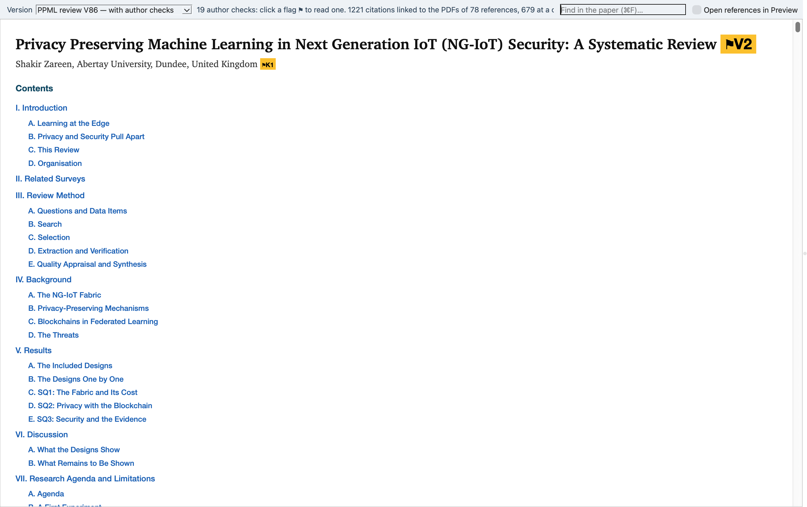

# Review Viewer

The review next to its sources: the built paper on the left; a click on a citation opens the cited study's evidence at its sentence, table or wording, and a click on an evidence item opens the page of the PDF with the quoted words outlined. Started by `Review Viewer.app` (macOS) or `python review_viewer.py [paper.docx]` with a Python that has PySide6 and pymupdf (the notes verifier's environment serves). The PDFs are the included studies' own copies, which are not part of the public release.

## Screenshots

Taken by `scripts/review/app_screenshot.py` on the real records; where a paper is shown it is Shawkat et al. 2025, published under CC BY 4.0.

**The Review Viewer on the built paper**

