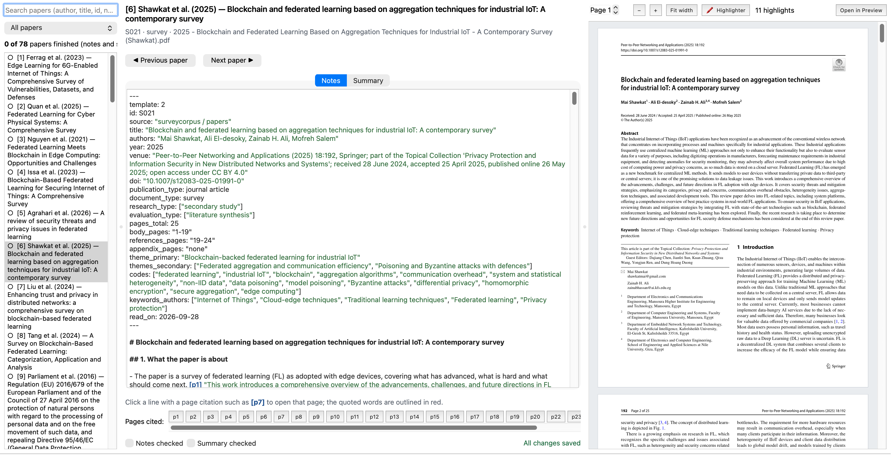
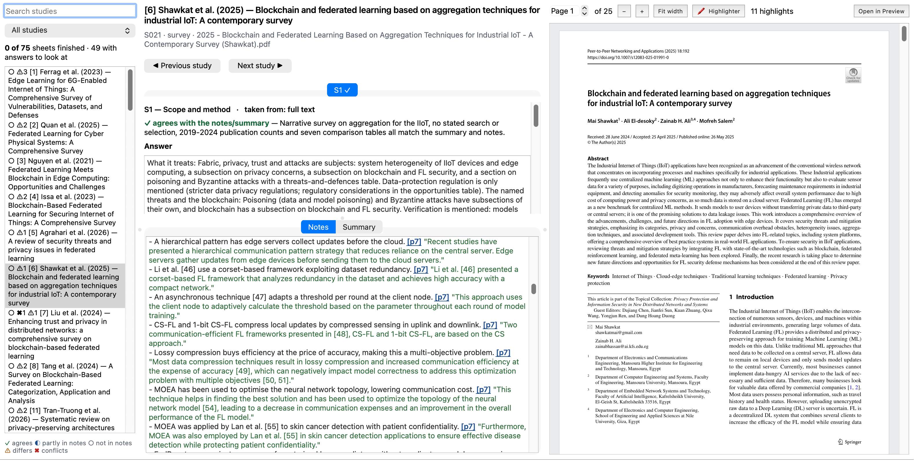
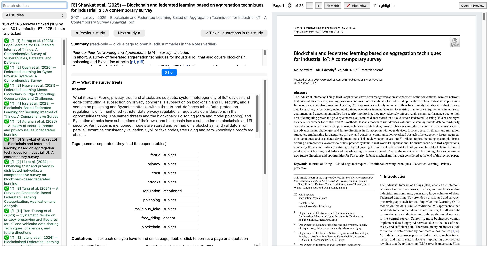

# Notes Verifier and Evidence Verifier

Two apps for checking the records behind the review, both opening the PDF beside them:

- **Notes Verifier** — the notes and summary of every paper cited in the review, against its PDF.
- **Evidence Verifier** — each study's evidence sheet (the record the paper's text and tables are built from), against
  its notes, summary and PDF.

# Notes Verifier

Check the notes and summary of every paper cited in the review against its PDF, side by side, and correct them.

## Start it

Double-click **Notes Verifier.app** in this folder, or run:

    notes-verifier/run.sh

## Use it

- **Left:** the papers cited in the review, numbered as in the paper. ○ not started · ✎ edited · ◐ half checked ·
  ✅ notes and summary both checked. Search by author, title, id or number; filter "Not finished" to see what is left.
- **Middle:** the notes and the summary (two tabs). Type to correct them.
- **Click a line** that cites a page such as **[p7]**: the PDF opens at that page and the quoted words are outlined in red.
  "Pages cited" lists every page the notes cite.
- **Right:** the PDF. Turn on **Highlighter** (or press H in the PDF), drag across text to highlight it; right-click a
  highlight to remove it. Highlights are saved in the PDF itself and show in Preview and Acrobat too.
- Tick **Notes checked** and **Summary checked** when you are done with a paper.

Shortcuts: ⌘S save now · ⌘↓ / ⌘↑ next / previous paper · ⌘1 / ⌘2 notes / summary · ⌘+ / ⌘− zoom.

## Your work is safe

- Notes and summaries save automatically one second after you stop typing, when you change paper or tab, and when you quit.
- Before a notes or summary file is first changed, the earlier text is kept in `history/<paper>/` (the very first version
  as `NOTES-original.md` / `SUMMARY-original.md`).
- Before a PDF gets its first highlight, an untouched copy is kept in `originals/<paper>/`.
- Your ticks are in `data/status.json`.

# Evidence Verifier

Start it with **Evidence Verifier.command** (alias on the Desktop) or `notes-verifier/run-evidence.sh`.

- **Left:** the 75 studies with evidence sheets. ✖ and ⚠ count the answers that contradict or differ from the notes;
  the filter "Need attention" shows only those studies.
- **Middle, top:** the sheet, one question at a time (tabs P1–P8 or S1–S8; the question that needs attention opens first).
  At the top, the result of the systematic check against the notes and summary, with the suggested correction. Below:
  the answer, its tags and its quotations — all can be corrected. Each quotation shows, live, whether it is in the notes or
  summary and on which page the notes cite it.
- **Middle, bottom:** the notes and summary; the line the selected quotation comes from is highlighted.
- **Right:** the PDF at the quoted page, quoted words outlined; highlighter as in the Notes Verifier.
- Tick **This answer is checked** for each answer; a sheet is finished when all its answers are ticked.

Sheets save automatically (complete file each time); the earlier sheet is kept in `history/<study>/SHEET-*.json`.
Your ticks are in `data/evidence-status.json`. The check results come from `search-ppml/evidence/sheets-vs-notes/`.

## What is in this folder

| File | What it is |
|---|---|
| `run.sh` | starts the app (sets itself up on first use) |
| `Notes Verifier.app` | the same, by double-click |
| `app.py` | the Notes Verifier |
| `evidence_app.py`, `run-evidence.sh`, `Evidence Verifier.command` | the Evidence Verifier |
| `build_list.py` | builds `data/papers.json`, the list of cited papers, from the newest version of the review |
| `setup.sh` | builds the app's own Python environment (`.venv`) |
| `data/` | the paper list and your ticks |
| `history/`, `originals/` | earlier versions of notes and summaries, untouched copies of highlighted PDFs |

`run.sh --refresh-list` rebuilds the list after a new version of the review; `run.sh --self-test` checks the app on
generated sample files.

# Sheet Reviewer

Start it with **Sheet Reviewer.command** or `notes-verifier/run-review.sh`. Each study's evidence sheet beside its PDF,
one answer at a time, with a tick per quotation and a tick per answer, recorded with the time in `data/sheet-review.json`.

- The form is `search-ppml/evidence/EXTRACTION-GUIDE-V3-2026-10-15.md`: one answer per review question — a design
  has P1 (the fabric and its cost), P2 (privacy with the blockchain) and P3 (security and the evidence); a survey has S1
  (what it treats). The tabs follow the sheet's answers.
- An answer merged on 15 October 2026 from parts of which one was new starts unticked and says so; tick the quotations
  still unticked once found in the PDF, correct the answer or its tags where needed, then tick the answer. Earlier
  sheets are kept in `history/<id>/`.
- A highlight you make in the reviewer's PDF (Highlighter on, drag across the words) is added to the open answer as a
  quotation on that page and ticked as found there; the same words are never added twice.
- Self-test: `notes-verifier/run-review.sh --self-test`.

# The highlighted corpus (15 October 2026)

`corpus/ppmlcorpus/highlighted/` holds a copy of every included study's PDF with the quotations of its current evidence
sheet highlighted in yellow ("Evidence sheet", with the answer), the author's own highlights kept, and the earlier
highlights of 12 October removed. All three apps open these copies (`INDEX.csv`); the study's own PDF stays untouched
in its folder. Remake them after the sheets change: `notes-verifier/.venv/bin/python notes-verifier/highlight_sheet_quotes.py --rebuild`
(close the apps first), then `notes-verifier/.venv/bin/python notes-verifier/build_list.py`.

## Screenshots

Taken by `scripts/review/app_screenshot.py` on the real records; where a paper is shown it is Shawkat et al. 2025, published under CC BY 4.0.

**The Notes Verifier: a cited paper beside its notes and summary**

**The Evidence Verifier: a study's evidence sheet against its notes and PDF**

**The Sheet Reviewer: every fact of a sheet ticked against the PDF**

