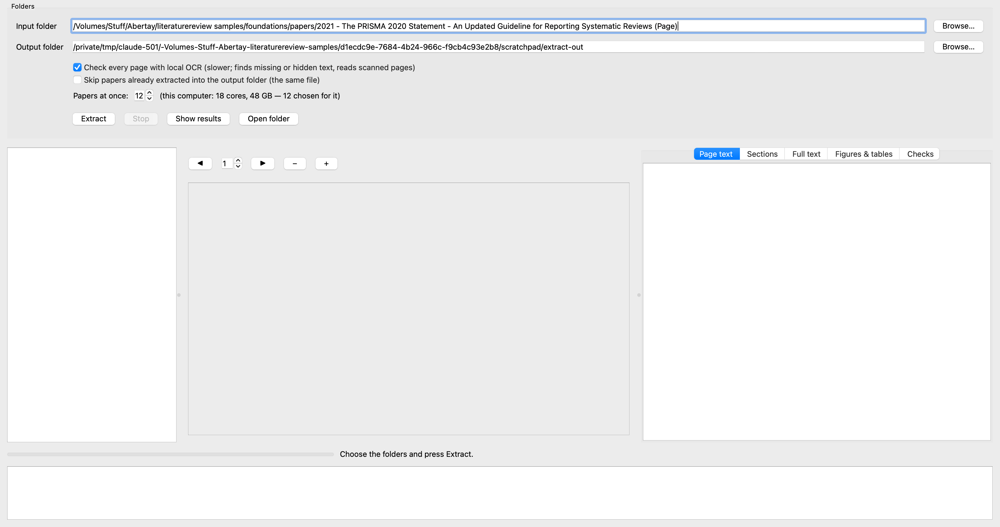

# PDF Text Extractor

Extracts the full text of PDF papers — every word, in reading order (two columns read column by column) — and checks it with
several independent methods: three engines read the PDF's text layer, and local OCR reads every page as it looks. Where the checks
disagree, OCR or another engine's reading corrects the text. Each paper gets its own folder: the full text, the text page by page,
the text broken into its sections, the figures and tables as images, and a report with the confidence of every page.

Runs on **macOS** and **Windows**. Everything happens on the computer: no paper is sent anywhere.

## Start

| System | First start | Afterwards |
| --- | --- | --- |
| macOS | double-click `start_mac.command` (right-click → Open the first time if macOS asks) | the **PDF Text Extractor** icon on the desktop |
| Windows | double-click `start_windows.bat` (if Windows warns, More info → Run anyway) | the **PDF Text Extractor** shortcut on the desktop |

The first start sets the app up by itself (a few minutes, with an internet connection): it installs `uv`, which fetches its own
Python 3.12 and every package the app needs into the app's own folder (`.venv`), checks the app on sample PDFs, and puts a
shortcut on the desktop. The packages are installed ready-built for the computer at hand (the newest versions that have a build
for it), so no compiler is needed. Nothing else on the computer is changed. To set the app up afresh, delete `.venv` and start
again. To use the app on another computer, copy this folder there and start it the same way: `.venv` is made for one computer,
and the start script sets it up anew when it does not run where it is.

Systems: macOS 12 or later (Apple silicon or Intel); Windows 10 or 11 (64-bit; on ARM laptops the x64 build runs under
Windows' emulation). Tesseract OCR is used as an extra engine when it is installed (macOS: `brew install tesseract`; Windows: the
UB Mannheim installer); the app works without it.

## Use

1. **Input folder**: the folder that holds the PDFs. **Output folder**: where each paper gets its folder.
2. **Extract**. Several papers are read at once, each in a Python process of its own: **Papers at once** is chosen for the
   computer (two thirds of its cores, no more than its memory carries at about 1.5 GB a paper, at most 16) and can be changed. The bar
   counts finished papers; the line beside it names the paper and page being read. **Stop** ends after the pages being read.
   Tick **Skip papers already extracted** (not ticked unless you tick it) to go on where a run stopped: a paper whose folder
   already holds the app's finished extraction of the same file (same name and contents) is then kept as it is.
3. Each paper is listed with its confidence (green 98 % and over, amber 95–98 %, red under 95 %). Click a paper: its pages show
   in the middle; the side panel on the right (drag its edge to widen or narrow it) shows the page's text with its checks, the
   sections, the full text, the figures and tables (double-click to go to the page), and the checks of every page.
   **Open folder** opens the paper's folder in Finder or Explorer.

## Output

```
<output>/<title>/          one folder per paper, named after its title
    <title>.pdf            a copy of the paper, named after its title
    full_text.txt          the verified full text, page by page ("===== Page n / N =====")
    full_text.md           the text broken into its sections, each with the pages it runs over
    sections.json          the sections, with every page of text they hold
    pages/page_NNNN.txt    the verified text of each page
    figures/, tables/      figures and tables as images (tables also as CSV where their cells can be read)
    report.json            the original file name, the title and where it was found, how every page was read and checked,
                           its confidence, and the corrections made
<output>/index.json        every paper with its confidence
```

The title is the PDF's own title where it is printed on the first page, else the largest type at the top of the first page,
else the file's name; it is made safe for Windows and macOS ("Title: subtitle" becomes "Title - subtitle") and cut at a word
when long. Extracting a paper again replaces the app's earlier folder for that same file. A folder of that name that the app did not make
(or that holds another paper whose name reads the same) is never touched: the paper goes to `<paper> (2)`. The app marks its own
folders with a small file, `.pdf-text-extractor.json`.

## How the text is checked

- **Three text engines.** MuPDF gives the reading text in the order the PDF lays its text down (for a publisher's two-column paper,
  column by column). PDFium and pdfminer read the same pages independently; pdfminer analyses the layout itself.
- **Local OCR of every page.** Apple Vision on a Mac, RapidOCR everywhere, Tesseract where installed. A page with a text layer
  is read by the main engine and one second engine (Tesseract where installed, whose layout analysis gives the second order of
  the page); where the counts of missing or hidden words come near a limit, the remaining engine reads the page too and every
  engine counts. A page without a text layer is read by every engine, to vote. (Three engines on every page gave the same text
  and verdicts on the papers tried, at three times the time.) Figures and tables are set
  aside, and over the words of the language: words OCR sees that the text lacks (*missing*; with two engines, both must see a
  word), words of the text that no OCR engine sees on the page (*hidden text*), and the *prose order*: OCR's lines of running
  prose found in the text in OCR's order — against the main engine's lines outside figures and tables, in column order, and,
  with Tesseract, against Tesseract's own layout analysis (the better of the two counts). The prose order is judged on every page and for every
  engine's reading: engines that share the PDF's content order agree with each other however that order runs.
- **Corrections.** A page with no text layer, or one that is an image under a publisher's stamp, is read by OCR, the OCR engines
  voting word by word. Where MuPDF's reading has under 90 % of its prose lines in OCR's order, or another engine's reading is
  better by at least 0.05, the best reading with at least 95 % in order (lacking no visible text, holding no hidden text) is
  used for the page; a reading that both OCR orders put in order is preferred. Where the two OCR orders back different readings
  and none satisfies both (a full-width figure or table between the columns), the page is listed for a look.
- **Tables are not prose.** A page whose prose order is not confirmed, with fewer than fifteen prose lines, whose text lines fall
  into three or more columns well apart and are mostly short, is a table (with or without rules): the order of its cells is
  not judged ("a table page"). Tables and figures are saved as images; the text checks concern the running text.
- **Sections.** From the PDF's outline (bookmarks) where it has one and every entry is found on its page; otherwise from the type
  of the headings (bold, larger, capitals, small capitals, italic) and their numbering (I, II … A, B … or 1, 2, 2.1 …), which must
  run on. Where neither runs on, the one that skips fewer numbers is used. A heading may have its number on a line of its own
  (letters too), a title that opens with a number or a letter of any script ("5G …", "Σ-…"), its number run onto a standard
  heading ("1Introduction"), or its words repeated smaller in a figure on the same page; a heading wrapped after a comma only
  fills the gap between its neighbours. Outline entries for tables or figures that cannot be found in order are set aside, not
  counted as missing. Every character of the text is in exactly one section.
- **Confidence of a page** is the lowest of: order (1 when OCR confirms the order of the prose, or the page has too little prose to
  order; otherwise the share of prose lines in order), completeness (missing text under 3 %) and visibility (hidden text under
  10 %); for a page read by OCR, the share of prose words another OCR engine reads alike. A paper's confidence is the mean over
  its pages, weighted by their text.

Tables and figures are saved as images for reference; the text checks concern the running text.

Started from the desktop, the app writes its messages to `app.log` in its own folder. From the command line it can start with
its folders filled in, and begin at once: `.venv/bin/python -m pdftextextractor --input <folder> --output <folder>
[--workers N] [--skip-done] [--start]`
(Windows: `.venv\Scripts\python -m pdftextextractor …`). While it extracts, the computer is kept from going to sleep (the
screen may still sleep).

## Check the app

`.venv/bin/python -m pdftextextractor.selftest` (Windows: `.venv\Scripts\python -m pdftextextractor.selftest`) builds sample PDFs —
two columns, two columns that the PDF lays down the wrong way round (another reading must stand in), an outline, a scanned page,
a table and a figure — runs them through the app (one at a time, and two at once in processes of their own), checks that a folder
the app did not make is left alone, checks the rules for lines OCR joins across the gutter, for titles and for headings (a letter
on a line of its own, words repeated in a figure, a heading wrapped after a comma, titles opening with "5G" or a Greek letter),
and opens the window off screen (24 checks; 23 with `--quick`, which leaves out the window).

## Screenshots

Taken by `scripts/review/app_screenshot.py` on the real records; where a paper is shown it is Shawkat et al. 2025, published under CC BY 4.0.

**The PDF Text Extractor, a folder of PDFs chosen**



