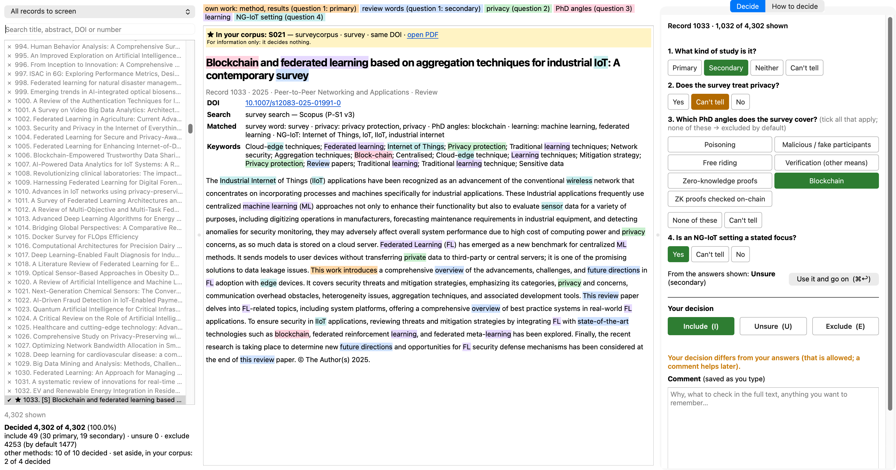

# The recorded search: strings, merge of the exports, automated rules, the screening application

The strings live in `strings.py` and `strings_regulation.py`; the exports are merged and de-duplicated by `merge.py`; the screening application serves the records to the reviewer; the second screening runs in batches. The database exports themselves are not redistributed (see EXCLUSIONS.md of the release); `search-ppml/exports/PROVENANCE-*.tsv` holds their checksums.

| Script | Purpose | Usage |
|---|---|---|
| `abstracts.py` | The author's reading file for the screening of the PPML review (primary and secondary studies). | `python3 scripts/search_ppml/abstracts.py` |
| `apply_corrections.py` | Apply the corrections of the decision check to the author's full-text answers, at the author's request (5 October 2026). | `python3 scripts/search_ppml/apply_corrections.py      (the screening app must be closed)` |
| `check_decisions.py` | Check the author's decisions on the 54 studies in the PPML review against the studies' own texts (5 October 2026). | `python3 scripts/search_ppml/check_decisions.py [--version N]   (a new version after corrections; earlier ones are kept)` |
| `corpus_coverage.py` | Every corpus paper (the supervisors' papers left out): is it in the Scopus and IEEE Xplore results of the PPML review, and if not, why not (4 October 2026, asked by the author). | `python3 scripts/search_ppml/corpus_coverage.py` |
| `corpus_match.py` | Which records of the PPML search are papers the author already holds (4 October 2026). | `python3 scripts/search_ppml/corpus_match.py` |
| `corrections_report.py` | The author's review page for the corrections applied on 5 October 2026 (apply_corrections.py). | `python3 scripts/search_ppml/corrections_report.py` |
| `file_export.py` | File one export of the PPML searches: copy it unchanged and unrenamed into search-ppml/exports/<source>/, count its records, and append its row (with SHA-256) to search-ppml/exports/PROVENANCE-2026-10-04.tsv. | `python3 scripts/search_ppml/file_export.py SEARCH SOURCE FILE ["results shown"] ["searched"]` |
| `file_included.py` | File the PDFs of the studies the author included in the PPML review that were not yet in the corpus (4 October 2026), into corpus/ppmlcorpus/surveys/<id>/ (all six are surveys), and extract each one as the corpus papers are. | `scripts/.venv/bin/python scripts/search_ppml/file_included.py` |
| `file_rs1_downloads.py` | File the full texts of the R-S1 candidates (supplementary regulation search; groups A, B and C pre-screened INCLUDE or UNSURE) that the author downloaded on 8 October 2026, and extract each with the corpus pipeline. | `scripts/.venv/bin/python scripts/search_ppml/file_rs1_downloads.py <mapping.json>     ({"RS1-043": "<file name>", …})` |
| `file_szk_downloads.py` | File the full texts of the S-ZK records the author included at title and abstract, and extract each with the corpus pipeline. | `scripts/.venv/bin/python scripts/search_ppml/file_szk_downloads.py <mapping.json> [--ids 501990 ...] [--jobs N]` |
| `merge.py` | Merge and de-duplicate the exports of the PPML review of surveys (searches of 4 October 2026, run by the author). | `python3 scripts/search_ppml/merge.py` |
| `other_methods.py` | Studies identified via other methods (PRISMA 2020): corpus papers on the review's topic that the database searches did not return (4 October 2026). | `python3 scripts/search_ppml/other_methods.py` |
| `prefill.py` | Pre-filled answers for the author's screening, by a fixed rule on cue words (4 October 2026). | `python3 scripts/search_ppml/prefill.py` |
| `primary_coverage.py` | How many of the corpus's primary studies each candidate primary-study search would retrieve (4 October 2026). | `python3 scripts/search_ppml/primary_coverage.py` |
| `prisma_report.py` | PRISMA 2020 flow and thematic tables of the PPML review after title-and-abstract screening (4 October 2026). | `python3 scripts/search_ppml/prisma_report.py` |
| `regulation_reading.py` | Reading file for the author's screening of a supplementary regulation search (8 October 2026). | `python3 scripts/search_ppml/regulation_reading.py <export.csv> <out.md>` |
| `regulation_screen.py` | AI pre-screening of groups A and C of the R-S1 records new to the PPML search (8 October 2026), for the author to confirm. | `python3 scripts/search_ppml/regulation_screen.py packets | check <file> | agree | final` |
| `rs1.py` | The supplementary search R-S1 as the PPML review records it (made part of the recorded search by the author, 8 October 2026). | `python3 scripts/search_ppml/rs1.py   (prints the numbers)` |
| `screening_app.py` | PPML Screening — the author's app for the title-and-abstract screening of the PPML review (primary and secondary studies, criteria search-ppml/CRITERIA-V2-2026-10-04.md). |  |
| `size_probe.py` | Size of candidate searches for a primary-study arm of the PPML review (4 October 2026), from OpenAlex counts. | `python3 scripts/search_ppml/size_probe.py` |
| `steps_doc.py` | The author's step sheet for the primary-study arm (strings version 4), with the strings taken from strings.py so that what the author pastes is exactly what is on record. | `python3 scripts/search_ppml/steps_doc.py` |
| `strings.py` | Search strings of the systematic review of surveys for the PPML paper (the V28 series), built from the author's PhD proposal, not from the corpus (the author, 4 October 2026: "look at my PhD proposal and give me a befitting search. | `python3 scripts/search_ppml/strings.py   -> prints every query` |
| `strings_regulation.py` | Search strings for studies on the regulatory side of privacy-preserving learning on ledgers in the NG-IoT (8 October 2026). | `python3 scripts/search_ppml/strings_regulation.py            prints every query with its term count` |
| `szk.py` | S-ZK: the searches of 2 October 2026 with ledger and zero-knowledge terms, taken into the PPML review as a supplementary search (the author, 12 October 2026: "our second series of searches did include ZKP"; "yes" to screening their new records). | `python3 scripts/search_ppml/szk.py <date>` |
| `szk_downloads.py` | The full texts to download for the S-ZK records the author included at title and abstract. | `python3 scripts/search_ppml/szk_downloads.py <date>` |
| `szk_pdfs.py` | Which S-ZK candidates already have a PDF in the workspace or in the author's download folder. | `python3 scripts/search_ppml/szk_pdfs.py <date>` |
| `szk_suggestions.py` | Claude's suggestions for the S-ZK records, made ready for the screening app — the author verifies every one. | `python3 scripts/search_ppml/szk_suggestions.py <date> [--accept-listed]` |
| `verify_decisions.py` | Verify every answer of the 54 studies in the PPML review with conclusive evidence (5 October 2026). | `python3 scripts/search_ppml/verify_decisions.py [--show]   (--show prints candidate full-text sentences for the` |

## Screenshots

Taken by `scripts/review/app_screenshot.py` on the real records; where a paper is shown it is Shawkat et al. 2025, published under CC BY 4.0.

Generated by `scripts/paper_ppml/folder_readmes.py` from each script's header; edit the headers, not this file.
